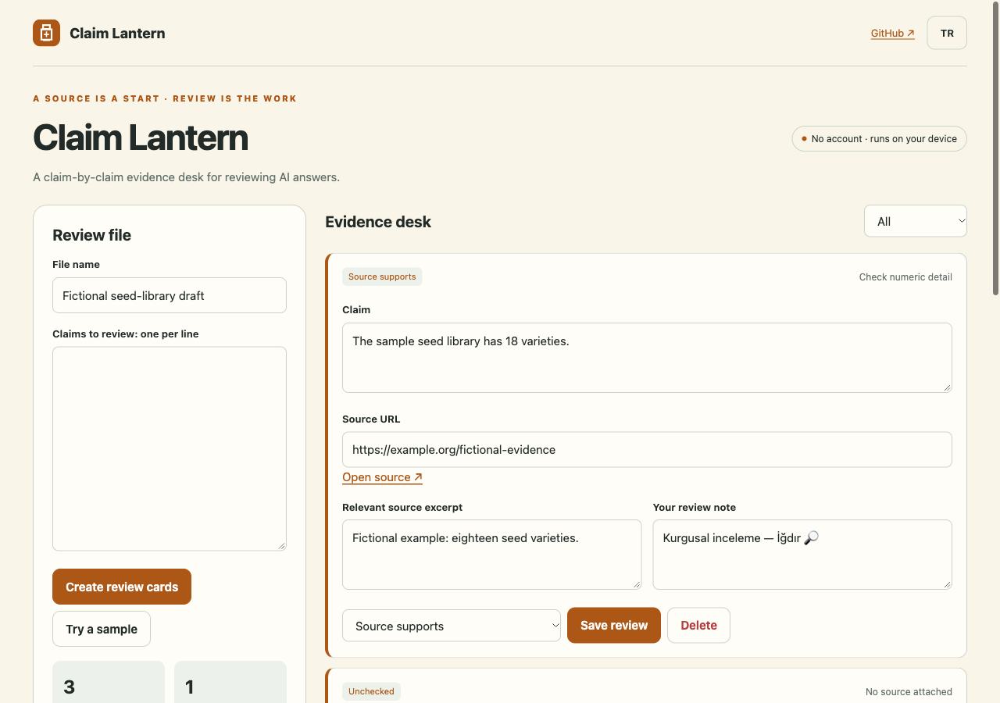

# Claim Lantern

A claim-by-claim evidence desk for reviewing AI answers.

**[Open the app](https://metealpkarvan.github.io/claim-lantern/)** · [Türkçe](README.tr.md) · [Download runnable ZIP](https://github.com/metealpkarvan/claim-lantern/releases/latest)

## Problem and idea

An answer can look sourced while references fail to support its actual statements. A bookmark alone does not record which sentence was checked or why a reviewer trusted it.

A small evidence desk that separates claim, source excerpt and reviewer judgment. Attaching a URL never changes a claim to supported automatically. The originating X/Twitter observation, access limitations and product inferences are documented in [research notes](docs/RESEARCH.md). This is an independent project, not an endorsed integration.

## Use it

1. Paste one claim per line and create unreviewed cards. Duplicate lines are collapsed.
2. Edit each claim into one checkable statement.
3. Open a source yourself, add its link and the relevant excerpt or review note.
4. Choose unchecked, source supports, source contradicts or inconclusive. Supported/contradicted requires a link plus an excerpt or note.
5. Filter pending work, save reviews and export a Markdown audit report or JSON backup.

## Back up and restore a review

1. Download a JSON backup before moving browsers or replacing a review. Keep that file somewhere you can find again.
2. In the destination app, choose **Import backup** and select the JSON file. The app checks its identity, version, size and complete review schema first.
3. Confirm replacement to load the review, or cancel to keep the current review. Import replaces the review; it does not merge cards.

Version 1.0.1 uses the same **10,000,000-byte limit (10 MB, decimal)** for JSON downloads and imports, measured as UTF-8 file bytes. A valid review exported by this version fits its importer, including large evidence notes, Turkish and other multibyte text, and characters escaped by JSON. The existing limits of 100 claims, field lengths and evidence requirements still apply. Version 1 backups remain supported.

Browser storage has its own quota and can be unavailable even when a backup is valid. Keep the downloaded JSON file if a local save fails; a backup import does not guarantee persistent browser storage.

Switch between Turkish and English. The sample button loads explicitly fictional data. After one successful online load, the service worker caches the app shell for offline reopening in the same browser. Browser support and storage settings vary; export important records.

## Download and run locally

The public demo needs no account or installation. Download **claim-lantern-v1.0.1.zip** from Releases, extract it and serve the extracted directory:

    python3 -m http.server 8080 --bind 127.0.0.1

Open http://127.0.0.1:8080. Use a local HTTP server rather than double-clicking index.html; browsers restrict ES modules on file URLs. Release ZIPs contain no credentials or private user records. Verify with the release checksum file:

    shasum -a 256 -c SHA256SUMS.txt

## Privacy and limits

All logic runs in the browser. No AI API, account, analytics, third-party font or remote database. Text is not uploaded. External links open only on user action. Records use a namespaced localStorage key. JSON backups are unencrypted personal files. Import checks app identity, version, size and schema before asking to replace records.

No automatic web fetch, truth score, plagiarism detection or citation existence check. Review statuses are user assessments. A source can itself be wrong, and a quoted passage may not support the claim.

## Development

    git clone https://github.com/metealpkarvan/claim-lantern.git
    cd claim-lantern
    npm test
    npm run build
    npm start

Node.js 22+ is needed for tests/build; the app has **zero runtime packages**. Python 3 serves the app. The dist directory is a complete static deployment. GitHub Actions tests Node 22 and 24 and validates before publishing to Pages.

Core checks: Review evidence gates, valid link protocols, draft preservation, duplicate records, numeric-detail flags and report caveats. Browser acceptance and limitations are recorded in [verification](docs/VERIFICATION.md).

See [architecture](docs/DECISIONS.md), [contributing](CONTRIBUTING.md), [roadmap](docs/ROADMAP.md) and [changelog](CHANGELOG.md).

MIT © 2026 Mete Alp Karvan

## Mac architecture support

The browser app supports both Intel and Apple Silicon Macs through a modern browser. No Rosetta or processor-specific app package is needed. CI runs the rule tests with native Node.js on x86_64 and arm64 macOS runners; browser/device coverage is separate from these checks. The downloaded ZIP contains the same architecture-independent HTML, CSS and JavaScript as the live app.
